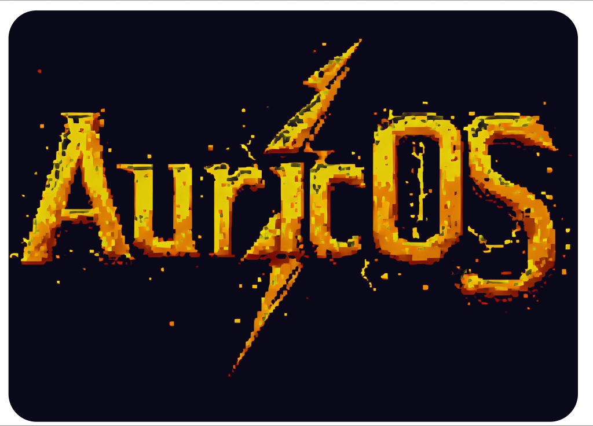
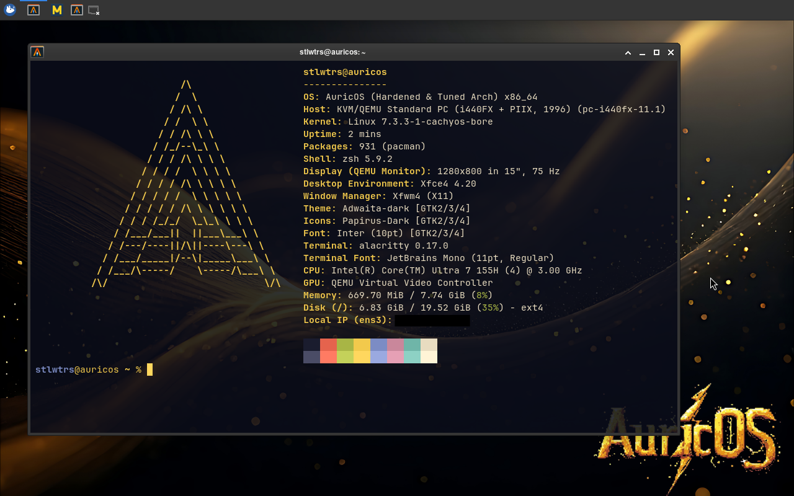
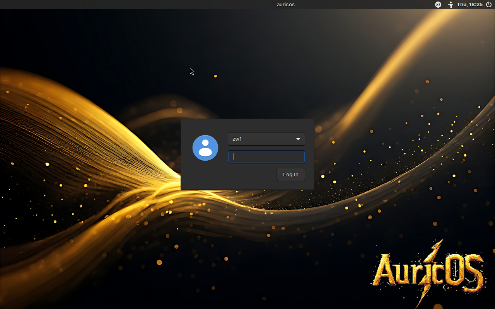
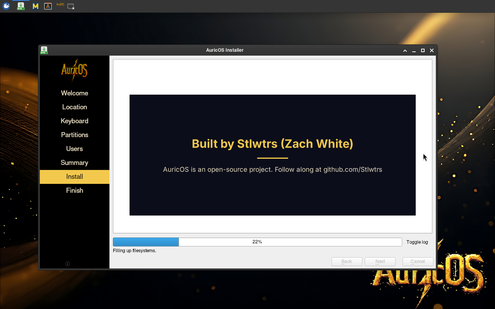
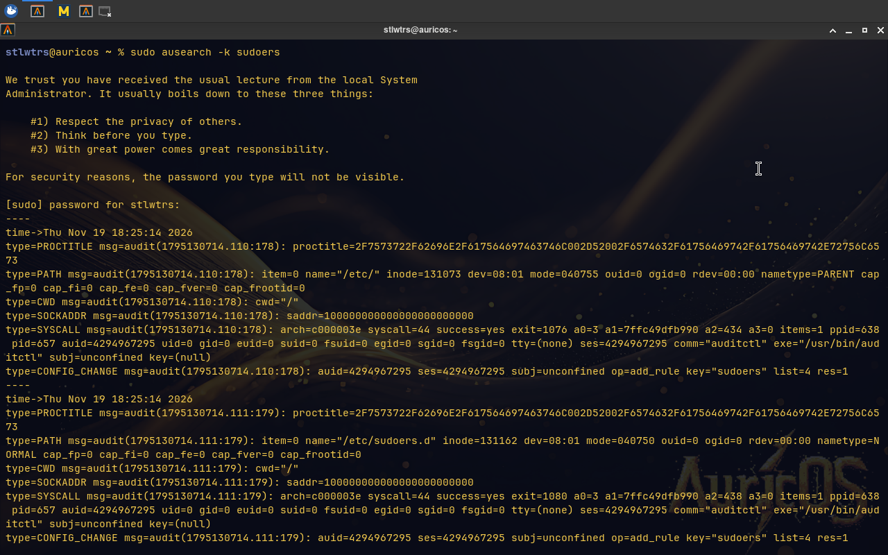
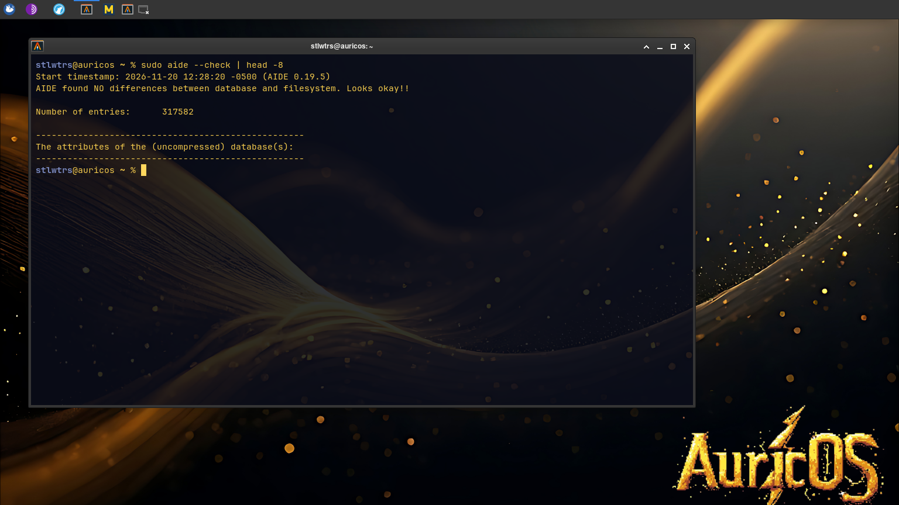

# AuricOS

**A security-hardened, Arch-based desktop distribution with a custom graphical installer.**

       

---

## Table of Contents

1. [Overview](#overview)
2. [Project Status](#project-status)
3. [Highlights](#highlights)
4. [Screenshots](#screenshots)
5. [Security Hardening](#security-hardening)
   - [Measured Results](#measured-results)
   - [Controls Implemented](#controls-implemented)
   - [Accepted Findings and Risk Decisions](#accepted-findings-and-risk-decisions)
6. [Architecture](#architecture)
   - [System Composition](#system-composition)
   - [Installer Pipeline](#installer-pipeline)
   - [Software Supply Chain](#software-supply-chain)
7. [Repository Layout](#repository-layout)
8. [Building AuricOS](#building-auricos)
9. [Testing and Verification](#testing-and-verification)
10. [First-Login Steps](#first-login-steps)
11. [Engineering Challenges and Lessons Learned](#engineering-challenges-and-lessons-learned)
12. [Roadmap](#roadmap)
13. [Contributing and Security Reports](#contributing-and-security-reports)
14. [Supporting AuricOS](#supporting-auricos)
15. [About the Name](#about-the-name)
16. [License](#license)
17. [Disclaimer](#disclaimer)

---

## Overview

AuricOS is a custom Linux distribution built from scratch with [archiso](https://wiki.archlinux.org/title/Archiso). It ships as a bootable live ISO with an XFCE desktop and a fully branded [Calamares](https://calamares.io/) graphical installer, and every system it installs is hardened by default.

The project had three goals:

1. **Build a complete distribution end to end:** a live environment, a graphical installer, and an installed system that boots and updates cleanly.
2. **Harden it measurably.** Every security change was validated against [Lynis](https://cisofy.com/lynis/) audits on fresh installs, raising the hardening index from **64 to 78** over three rounds.
3. **Document the decisions,** including the recommendations deliberately *not* applied and why, so the security posture is explainable rather than just scored.

AuricOS pairs Arch Linux's packages and rolling updates with the **CachyOS BORE kernel** for desktop responsiveness, and ships privacy-focused browsers alongside security tooling.

---

## Project Status

> **AuricOS is in active development (v1.0 beta).** The live ISO, installer, and hardened installed system are functional and tested in QEMU/KVM. Pre-built ISOs are not yet published; see [Building AuricOS](#building-auricos) to build from source.

| Component | Status |
| --- | --- |
| Live ISO (BIOS) | ✅ Working |
| Calamares installer | ✅ Working |
| Hardening (3 rounds) | ✅ Complete, Lynis 64 → 78 |
| CachyOS BORE kernel | ✅ Working |
| UEFI installation | 🔄 Configured, testing in progress |
| Physical hardware | 🔄 Planned |
| Live-session auto-login | 🔄 Planned |
| Pre-built ISO releases | 🔄 Planned |

**Development time:** approximately 88 hours as of November 20, 2026.

Changes are tracked in [CHANGELOG.md](CHANGELOG.md).

### How AuricOS Was Built

AuricOS was developed with substantial assistance from **Claude** (Anthropic's AI assistant), which drafted much of the configuration and many of the commands used in the project. I myself set the project's direction and design decisions, built and tested every ISO, and verified each change on fresh installations, catching and debugging issues along the way. All hardening results in this README come from Lynis audits run on those test installs.

---

## Highlights

| Area | What AuricOS delivers |
| --- | --- |
| **Installer** | Branded Calamares 3.4.2 installer with a custom navy-and-gold theme, slideshow, password policy, and an automated post-install hardening and cleanup stage |
| **Hardening** | Default-deny firewall, AppArmor MAC, 25 kernel and network sysctl controls, auditd with a custom ruleset, AIDE file integrity monitoring, PAM password-quality enforcement, and more |
| **Measured security** | Lynis hardening index raised from **64 → 78**; suggestions reduced from **30 → 13**, with every remaining item documented |
| **Kernel** | CachyOS `linux-cachyos-bore` kernel on an Arch Linux base, with repository priority configured so only the kernel comes from CachyOS |
| **Supply chain** | AUR packages built in clean chroots, PGP-verified upstream sources, served from a local signed-off repository |
| **Privacy** | Mullvad Browser, Tor Browser, and LibreWolf preinstalled; SSH disabled; root account locked |
| **Desktop** | XFCE with a custom panel layout, Alacritty terminal (transparent, gold palette), zsh, fastfetch, and a unified wallpaper and login theme |

---

## Screenshots

| Desktop | Installer |
| --- | --- |
|  |  |
| **Login screen** | **Installer slideshow** |
|  |  |
| **Audit logging (auditd)** | **File integrity (AIDE)** |
|  |  |

---

## Security Hardening

### Measured Results
All scores come from **Lynis 3.1.7** (`lynis audit system --quick`) run on a **fresh installation** from each ISO build in a QEMU/KVM virtual machine, not from a live session. What each round changed, how it was verified, and the problems found along the way are recorded in [`docs/hardening/`](docs/hardening/). Raw Lynis reports are in [`docs/lynis/`](docs/lynis/) from round 4 onward.

| Stage | Changes | Tests run | Hardening index | Suggestions |
|---|---|:--:|:--:|:--:|
| **[Baseline](docs/hardening/round-0-baseline.md)** | Stock install | 239 | **64** | 30 |
| **[Round 1](docs/hardening/round-1.md)** | Firewall, AppArmor, auditd, kernel/network sysctl, core dumps disabled | 244 | **72** | — |
| **[Round 2](docs/hardening/round-2.md)** | Login banner, umask, password hashing and quality, protocol blacklist, compiler restriction, sysstat | 244 | **75** | 16 |
| **[Round 3](docs/hardening/round-3.md)** | auditd ruleset, AIDE, ufw sysctl fix, SSH config permissions | 247 | **78** | 13 |
| **[Round 4](docs/hardening/round-4.md)** | Copy Fail mitigation (`algif_aead` blocked), bundled CopyFix, USBSnitch and hextcp, AIDE database exclusion | 247 | **78** | — |

> **Why didn't round 4 raise the score?** Lynis has no tests for the Copy Fail vulnerability, USB device alerts or the bundled tools, so round 4 is verified with its own checks instead (listed in the [round 4 record](docs/hardening/round-4.md)). The unchanged test count shows the round broke no existing check.

> **Why not 100?** Many Lynis checks reward server-oriented configurations (remote log hosts, separate `/var` partitions, configuration-management agents). Applying them to a single-user desktop would add complexity or break normal use without reducing meaningful risk. Every remaining finding is explained in [Accepted Findings](#accepted-findings-and-risk-decisions).


### Controls Implemented

#### Network

| Control | Implementation |
| --- | --- |
| Default-deny firewall | `ufw` enabled at install time: deny incoming, allow outgoing |
| Spoofing and redirect protection | Reverse-path filtering, ICMP redirect and source-route rejection, SYN cookies, broadcast-ICMP ignore (`/etc/sysctl.d/99-auricos-hardening.conf`) |
| Martian packet logging | `log_martians=1`, including a fix for `ufw`'s own sysctl file, which silently overrode it |
| Unused protocols disabled | `dccp`, `sctp`, `rds`, `tipc` blocked via `/etc/modprobe.d/auricos-blacklist.conf` |
| Remote access | `sshd` disabled on installed systems; archiso's permissive SSH drop-in removed; `sshd_config` restricted to `600` |

#### Kernel

| Control | Implementation |
| --- | --- |
| Mandatory access control | AppArmor enabled through the kernel's `lsm=` parameter, injected into GRUB by the installer; 160+ profiles loaded |
| Kernel information leaks | `kptr_restrict=2`, `dmesg_restrict=1` |
| Process isolation | `yama.ptrace_scope=1`, `perf_event_paranoid=3` |
| BPF hardening | `unprivileged_bpf_disabled=1`, `bpf_jit_harden=2` |
| Filesystem protections | `protected_fifos=2`, `protected_regular=2`, `suid_dumpable=0` |
| Misc. attack surface | `sysrq=0`, `tty.ldisc_autoload=0`, FireWire storage modules blocked |
| Core dumps | Disabled via systemd-coredump and `limits.d` to prevent credential leakage from crashed processes |

#### Authentication and Accounts

| Control | Implementation |
| --- | --- |
| Root account | Locked on every install (`passwd -l root`); administration through `sudo` and the `wheel` group |
| Installer password policy | Empty and short passwords rejected (minimum 8 characters) |
| Password quality | `pam_pwquality` enforced in `system-auth`: dictionary check, username check, repeated-character limit |
| Password hashing | yescrypt cost factor raised to 7 (4× default work) |
| Default permissions | `umask 027` in both `login.defs` and `/etc/profile`, so new files are not world-readable |
| Login banner | Authorized-use warning in `/etc/issue` |

#### Auditing and Integrity

| Control | Implementation |
| --- | --- |
| Audit logging | `auditd` with 16 rules watching identity files, sudoers, PAM, SSH, sysctl, modprobe, firewall, AppArmor, and systemd unit changes, plus `sudo` execution and kernel module load/unload syscalls |
| File integrity | AIDE baseline covering \~400,000 files, checked on a schedule by `aidecheck.timer` |
| Vulnerability awareness | `arch-audit` checks installed packages against Arch Linux security advisories |
| System statistics | `sysstat` collection and summary timers |

#### Toolchain

| Control | Implementation |
| --- | --- |
| Compiler restriction | `gcc`, `cc`, `as`, `ld`, `clang` and related tools restricted to `root:wheel`, mode `750`, so a compromised unprivileged account cannot build exploits locally |
| Persistence across updates | A pacman hook re-applies the restriction whenever a compiler package is upgraded |

**Audit logging in action.** Creating a file in `/etc/sudoers.d/` is captured with the originating user (`auid`), even though the action ran as root through `sudo`:

```text
type=SYSCALL ... syscall=openat success=yes ... auid=<user> uid=root euid=root
  comm=touch exe=/usr/bin/touch key=sudoers
```

### Accepted Findings and Risk Decisions

Lynis still reports 13 suggestions. Each one was reviewed and either accepted as a deliberate trade-off, identified as a false positive, or scheduled.

| Lynis ID | Suggestion | Decision | Rationale |
| --- | --- | --- | --- |
| FILE-6310 | Separate `/home` partition | Accepted | Server-oriented. A single-user desktop gains little, and fixed partition sizes create real usability problems. |
| FILE-6310 | Separate `/var` partition | Accepted | Same reasoning as above. |
| USB-1000 | Disable USB storage | Accepted | Would break flash drives and external disks, a core desktop use case. |
| AUTH-9286 | Minimum password age | Accepted | Forced rotation policies are discouraged by NIST SP 800-63B. |
| AUTH-9286 | Maximum password age | Accepted | Periodic forced changes push users toward weaker, predictable passwords (NIST SP 800-63B). |
| LOGG-2154 | Remote logging host | Accepted | No log aggregation infrastructure exists for a personal desktop. |
| TOOL-5002 | Configuration-management tools | Accepted | Ansible/Puppet-style tooling is meant for managing fleets, not single machines. |
| NAME-4028 | DNS domain name | Accepted | Only meaningful on managed corporate networks. |
| ACCT-9622 | Process accounting | Accepted | Package not in official repositories; per-command accounting adds little on a single-user system already covered by auditd. |
| KRNL-6000 | `kernel.modules_disabled=1` | Accepted | Blocks *all* module loading after boot, which breaks hot-plugged USB, Wi-Fi, and other devices. Module loads are audited instead. |
| PKGS-7398 | Install a package audit tool | False positive | `arch-audit` is installed and functional; Lynis does not detect it on Arch. |
| CRYP-7902 | Expired certificate | False positive | The flagged file is `sks-keyservers.netCA.pem`, shipped by `gnupg` for a keyserver pool shut down in 2021. It is unused and restored by every `gnupg` update. |
| BOOT-5264 | Harden systemd services | Planned | Per-service sandboxing is on the [roadmap](#roadmap). |

**Usability decision:** unprivileged user namespaces were deliberately left *enabled*. Disabling them is a common hardening recommendation, but it breaks the sandboxes used by Mullvad Browser, Tor Browser, and LibreWolf, which would reduce real-world security.

---

## Architecture

### System Composition

| Component | Choice |
| --- | --- |
| Base | Arch Linux (`core`, `extra`) |
| Kernel | `linux-cachyos-bore` from the CachyOS repository |
| Repository priority | `[cachyos]` listed after `[extra]`, so Arch builds take precedence and only packages Arch does not ship (the kernel) come from CachyOS |
| Bootloader | GRUB (BIOS and UEFI configuration provided) |
| Init | systemd |
| Desktop | XFCE with Whisker Menu, Docklike taskbar, LightDM GTK greeter |
| Shell and terminal | zsh, Alacritty (0.85 opacity, custom gold palette), fastfetch |
| Theme | Adwaita-dark, Papirus-Dark icons, Inter and JetBrains Mono fonts |
| Browsers | Mullvad Browser, Tor Browser, LibreWolf |
| Security tooling | Metasploit Framework, Lynis, arch-audit, AIDE, auditd, AppArmor, ufw |

### Installer Pipeline

The installer is Calamares 3.4.2 with a custom module sequence. The `exec` phase runs:

```text
partition → mount → unpackfs → shellprocess@kernel → shellprocess@cleanup
→ machineid → fstab → locale → keyboard → localecfg → users
→ shellprocess@lockroot → networkcfg → hwclock → initcpiocfg → initcpio
→ grubcfg → bootloader → umount
```

Three custom `shellprocess` stages turn the live image into a clean, hardened installed system:

**1. `shellprocess@kernel`** (runs outside the chroot) Copies the kernel image from the ISO's boot partition into the target's `/boot`, since archiso keeps the kernel outside the squashfs root filesystem.

**2. `shellprocess@cleanup`** (runs inside the target)

- Removes live-only components: archiso's initramfs override, root autologin, the live account-creation service, the `pacman-init` tmpfs keyring mount, mirror-selection and accessibility services
- Removes the build-time local repository and its `pacman.conf` entry so installed systems update only from public mirrors
- Uninstalls Calamares itself and swaps in a panel layout without the installer launcher
- Initializes and populates a fresh pacman keyring
- Applies hardening: enables ufw, AppArmor, auditd, and sysstat; installs the login banner; sets umask and password hashing policy; wires `pam_pwquality` into PAM; restricts compilers; fixes ufw's `log_martians` override; tightens `sshd_config`
- Strips a package-database field written by the build host's newer pacman, which otherwise produced warnings on every `pacman` command

**3. `shellprocess@lockroot`** (runs after the `users` module) Locks the root account and sets the new user's shell to zsh. This stage exists because the `users` module runs *after* the cleanup stage and would otherwise re-enable a root password (see [Lessons Learned](#engineering-challenges-and-lessons-learned)).

Additional installer configuration:

- **`users.conf`:** root password disabled, password requirements, `wheel` as the sudo group, `auricos` as the default hostname
- **`grubcfg.conf`:** injects the AppArmor `lsm=` kernel parameter
- **`initcpio.conf`:** builds initramfs for every installed kernel, independent of kernel package name
- **Branding:** custom sidebar colors, logo, and a QML slideshow shown during installation

### Software Supply Chain

Packages not available in the official repositories (Calamares, AIDE, Mullvad Browser, LibreWolf) are built from the AUR and served from a local pacman repository during ISO builds:

- **Clean-chroot builds.** Packages are built with `extra-x86_64-build` (devtools) so they link only against current official libraries. This resolved a real defect where a host-built Calamares linked against a stale `libpython3.11`.
- **Source signature verification.** Upstream PGP signatures are verified before building. For AIDE, the maintainer's signing key was imported and its fingerprint cross-checked against the upstream project before the build was allowed to proceed. Signature checks were never bypassed.
- **PKGBUILD review.** Build scripts are read before execution, since AUR packages are user-submitted.
- **Minimal repository contents.** Debug packages and build helper files are excluded from the repository.
- **No build artifacts on installed systems.** The local repository and its configuration are removed during installation.

---

## Repository Layout

```text
AuricOS/
├── airootfs/                         # Files overlaid onto the live and installed root filesystem
│   ├── etc/
│   │   ├── audit/rules.d/            # auditd ruleset (50-auricos.rules)
│   │   ├── calamares/
│   │   │   ├── settings.conf         # Installer module sequence
│   │   │   ├── branding/auricos/     # Theme, logo, slideshow (show.qml)
│   │   │   └── modules/              # users, bootloader, grubcfg, initcpio, unpackfs, shellprocess stages
│   │   ├── modprobe.d/               # Protocol and FireWire blacklist
│   │   ├── pacman.d/hooks/           # Compiler-restriction hook
│   │   ├── security/                 # pwquality rules, core-dump limits
│   │   ├── skel/                     # Default user configuration (XFCE, Alacritty, fastfetch, zsh)
│   │   ├── sysctl.d/                 # Kernel and network hardening
│   │   └── systemd/                  # Core-dump policy, services
│   └── usr/
│       ├── local/bin/                # Installer and hardening helper scripts
│       └── share/                    # Branding assets, installer launcher, staged config files
├── grub/ syslinux/ efiboot/          # Boot menu configuration (BIOS and UEFI)
├── docs/                             # Lynis reports, screenshots, logo, PGP public key
├── scripts/                          # Maintainer tooling (pre-publication checks)
├── .github/                          # Issue templates and funding configuration
├── packages.x86_64                   # Package list
├── pacman.conf                       # Build-time repository configuration
├── profiledef.sh                     # ISO metadata and file permissions
├── CHANGELOG.md  CONTRIBUTING.md  SECURITY.md
└── LICENSE                           # GPL-3.0
```

---

## Building AuricOS

### Requirements

- An Arch-based host with `archiso` and `devtools` installed
- Access to the CachyOS repository and keyring
- A local repository containing the AUR-built packages listed in `packages.x86_64`

### 1. Build AUR packages into the local repository

```bash
git clone https://aur.archlinux.org/<package>.git
cd <package>
less PKGBUILD                       # review before building
extra-x86_64-build                  # clean-chroot build
sudo cp <package>-<version>-x86_64.pkg.tar.zst /opt/auricos-repo/
sudo repo-add /opt/auricos-repo/auricos.db.tar.gz /opt/auricos-repo/<package>-<version>-x86_64.pkg.tar.zst
```

### 2. Build the ISO

```bash
git clone https://github.com/Stlwtrs/AuricOS.git
cd AuricOS
sudo mkarchiso -v -w work -o out .
```

The finished image is written to `out/`.

---

## Testing and Verification

Every change was tested by booting the ISO in QEMU/KVM, installing to a blank virtual disk, and verifying the installed system.

```bash
qemu-img create -f qcow2 auric-test.qcow2 20G

# Live session + installer
qemu-system-x86_64 -m 8192 -smp 4 -enable-kvm -cpu host -vga virtio \
  -boot d -cdrom out/<iso-name>.iso \
  -drive file=auric-test.qcow2,format=qcow2

# Installed system
qemu-system-x86_64 -m 8192 -smp 4 -enable-kvm -cpu host -vga virtio \
  -drive file=auric-test.qcow2,format=qcow2
```

### Post-install verification checklist

```bash
uname -r                                  # contains "cachyos-bore"
sudo passwd -S root                       # "L" (locked)
echo $SHELL                               # /bin/zsh
systemctl is-enabled sshd                 # disabled
sudo ufw status verbose                   # active, deny (incoming)
cat /proc/cmdline                         # includes apparmor in lsm=
sudo aa-status | head -3                  # AppArmor loaded
sysctl kernel.kptr_restrict               # 2
modprobe -n -v sctp                       # install /bin/false
umask                                     # 0027
grep pwquality /etc/pam.d/system-auth     # pam_pwquality present
ls -l /usr/bin/as /usr/bin/ld             # root wheel, -rwxr-x---
sudo auditctl -l | wc -l                  # 16
stat -c '%a' /etc/ssh/sshd_config         # 600
sudo lynis audit system --quick           # hardening index
```

---

## First-Login Steps

AIDE must build its baseline on the finished system, since the installer modifies thousands of files after any point where a baseline could be captured:

```bash
sudo aide --init
sudo mv /var/lib/aide/aide.db.new.gz /var/lib/aide/aide.db.gz
sudo systemctl enable --now aidecheck.timer
sudo aide --check
```

---

## Engineering Challenges and Lessons Learned

Selected problems encountered during development, and how they were diagnosed:

**Installer linked against a missing library.** Calamares failed to start with a missing `libpython3.11`. Inspecting the direct dependencies of the binary alone was misleading; the stale link was in `libcalamares`. Rebuilding in a clean chroot with `extra-x86_64-build` produced a package linked against the current Python. *Lesson: build distribution packages in clean environments, and check shared-library dependencies transitively.*

**Root account silently re-enabled.** The cleanup stage locked root, yet `passwd -S root` on installed systems showed a usable password. The Calamares `users` module runs after the cleanup stage and was reusing the user's password for root. The fix disabled root password setting in `users.conf` and added a dedicated `lockroot` stage after `users`. *Lesson: verify security controls on the final artifact, not on the step that applied them.*

**A hardening file that never shipped.** After round 1, Lynis improved by only four points. Checking the live value of `kernel.kptr_restrict` showed the sysctl file was never applied. It had been saved outside the `airootfs` tree, so it never reached the ISO. *Lesson: a configuration change is not done until its effect is observed on the running system.*

**A firewall quietly undoing a kernel setting.** `log_martians` remained `0` despite being set in `sysctl.d`, because `ufw` applies its own sysctl file at startup, after the system's. The fix edits `ufw`'s configuration at install time rather than fighting the load order. *Lesson: security tools can override one another; trace where a value is actually set.*

**Package-owned file conflicts.** Shipping files such as `/etc/skel/.zshrc` or `/etc/issue` directly in `airootfs` collides with files owned by packages. These are now staged under `/usr/share/auricos/` and copied into place by the installer. *Lesson: work with the package manager's ownership model, not around it.*

**Cross-version package database warnings.** Every `pacman` command printed warnings about an unknown `%INSTALLED_DB%` key. The cause was a field written by the build host's newer pacman that the installed system's version did not recognize. A cleanup step now strips the field. *Lesson: build-host tooling can leak into the artifact.*

**Scanner output requires interpretation.** Several Lynis findings were false positives (`arch-audit` not detected, an obsolete certificate shipped by `gnupg`), and others conflicted with desktop usability. Each was investigated through the Lynis log before being accepted or fixed. *Lesson: a score is an input to judgment, not a substitute for it.*

---

## Roadmap

- [ ] Replace the live-session account form with an auto-login live user
- [ ] Per-service systemd sandboxing (`systemd-analyze security`) for exposed services (Lynis BOOT-5264)
- [ ] UEFI install testing and Secure Boot investigation
- [ ] Testing on physical hardware
- [ ] Optional full-disk encryption (LUKS) in the installer
- [ ] Custom AppArmor profiles for bundled applications
- [ ] Automated ISO builds and verification in CI
- [ ] Signed ISO releases with published checksums

---

## Contributing and Security Reports

Bug reports, testing feedback, and hardening suggestions are welcome. See [CONTRIBUTING.md](CONTRIBUTING.md) for how to build, test, and submit changes.

**Found a security issue?** Please do not open a public issue. Follow the private reporting process in [SECURITY.md](SECURITY.md).

---

## Supporting AuricOS

AuricOS is developed independently. Donations fund testing hardware, build infrastructure, and development time.

| Method | Details |
| --- | --- |
| **USD** | [Sponsor on GitHub](https://github.com/sponsors/Stlwtrs) | *(Coming Soon!)*
| **Monero (XMR)** | `858qRMmuqwCe1aWTukeVK2LQ1F1uNT6rD2WwEpA7ixP6V8M6LPzGSC8gUgdZKBFTs9iD7hWG7CDx5dMWJx5BfdGeLULkZBz` |
| **Bitcoin (BTC)** | `bc1qfs2l0qhcrfgq3mywvzewc3kwpvfmn4p4egku96` |

> **Verify before sending.** Donation addresses are published only in this repository. Confirm they match the PGP-signed copy in [`DONATE.asc`](DONATE.asc), verifiable with the project's public key in [`docs/pgp-key.asc`](docs/pgp-key.asc):
> 
> ```bash
> gpg --import docs/pgp-key.asc
> gpg --verify DONATE.asc
> ```

---

## About the Name

AuricOS is named after **Auric Ore** from the [Calamity Mod](https://calamitymod.com/) for Terraria. Auric gear is late-game material: forged from the hardest-won resources in the game, and strong enough to stand up to its toughest bosses. It is the gold standard of the mod's arsenal, and that is the bar AuricOS aims for as a secure desktop and is exactly why I chose this name for the OS.

The name also sets the project's visual identity, from the gold-and-navy theme to the logo.

If you play Terraria, check out the Calamity Mod and support the team behind it:

|  |  |
| --- | --- |
| **Official website** | [calamitymod.com](https://calamitymod.com/) |
| **Wiki** | [calamitymod.wiki.gg](https://calamitymod.wiki.gg/) |
| **Steam Workshop** | [Calamity Mod on Steam](https://steamcommunity.com/sharedfiles/filedetails/?id=2824688072) |
| **Source (public mirror)** | [CalamityTeam/CalamityModPublic](https://github.com/CalamityTeam/CalamityModPublic) |
| **Support the developers** | [Patreon](https://patreon.com/CalamityMod) |

> AuricOS is an independent project and is not affiliated with or endorsed by the Calamity Mod team or Re-Logic. Terraria is a trademark of Re-Logic.

---

## License

AuricOS is licensed under the [GNU General Public License v3.0](LICENSE), consistent with [archiso](https://gitlab.archlinux.org/archlinux/archiso), on which the build profile is based. Bundled third-party software remains under its respective licenses.

---

## Disclaimer

AuricOS is a personal and educational project built to learn Linux distribution engineering and system hardening. It has not undergone an independent security audit and is not intended for production or high-risk use. Use it at your own risk.

---

Built by [Stlwtrs](https://github.com/Stlwtrs)
